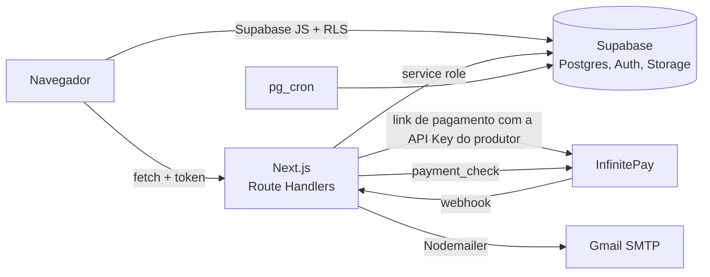

# 🎟️ EventAqui - Plataforma de Gestão e Venda de Ingressos

O **EventAqui** é um sistema web completo e responsivo desenhado para promover criação e divulgação de eventos, venda de ingressos com PIX ou cartão de crédito e a gestão de portaria através de leitura de QR Code.

**Demo:** [eventaqui.vercel.app](https://eventaqui.vercel.app/como-funciona)


[](https://github.com/JulioCedraz/eventaqui/actions/workflows/ci.yml)

## ✨ Principais Funcionalidades

### Para o Usuário (Cliente)
* **Vitrine de Eventos:** Exploração de eventos em um grid responsivo e moderno.
* **Autenticação Segura:** Criação de conta com confirmação de e-mail e login protegido.
* **Checkout Rápido:** Compra de ingressos com **PIX** ou **cartão de crédito** no checkout hospedado da InfinitePay, cupons de desconto e ingresso "casadinha" com convite por e-mail para o acompanhante.
* **Meus Ingressos:** Painel para visualizar ingressos comprados, com QR Code de entrada em visual de "bilhete" e status de pagamento atualizado automaticamente.

### Para o Produtor de Eventos
* **Hub Administrativo:** Dashboard centralizado com atalhos rápidos e interface fluida.
* **Recebimentos Diretos:** O produtor conecta a própria conta InfinitePay com a InfiniteTag e a API Key do Checkout, guardada criptografada. O valor das vendas cai direto na conta dele.
* **Dashboard de Vendas:** KPIs de receita bruta, ingressos vendidos e valores aguardando pagamento, com filtros por evento, status e cupom.
* **Gestão de Eventos e Cupons:** Criação e edição de eventos com upload de capa, limite de vagas e cupons por evento.
* **Gestão de Equipe (Agentes):** Recrutamento de agentes de portaria com convite por e-mail. O agente usa o leitor de QR Code integrado para validar os ingressos na entrada e evitar fraudes e duplicidades.

### Engine e Integrações
* **Checkout Integrado da InfinitePay:** Cada pedido gera um link de pagamento único na conta do produtor, que expira junto com a reserva de 30 minutos. PIX sem taxa; no cartão, vale a taxa da InfinitePay. A plataforma não cobra taxa.
* **Regras de Preço:** Eventos são gratuitos ou têm valor mínimo de R$ 1,00. O valor cobrado é sempre recalculado no servidor, incluindo cupons e vagas disponíveis.
* **Onboarding de Convidados:** Usuários convidados recebem um link mágico por e-mail e são levados à conclusão do perfil e à definição de senha.
* **Agentes Compartilhados entre Produtores:** O agente de portaria cria a conta uma única vez. Qualquer produtor pode adicioná-lo à própria equipe pelo e-mail, e o acesso aos eventos daquele produtor é liberado sem novo cadastro.
* **Baixa Automática (Webhook):** A notificação da InfinitePay não tem assinatura, então só dispara uma consulta ao `payment_check` com a chave do produtor. O ingresso é aprovado só se o pagamento estiver pago, com o valor do pedido e uma transação ainda não usada. A volta do checkout faz a mesma conferência.
* **Pedidos Vencidos:** Um job do `pg_cron` cancela pedidos pendentes vencidos. Pagamento que chega depois do prazo só vira ingresso se ainda houver vaga; senão, o produtor recebe um e-mail para estornar.

### Segurança e Conformidade (LGPD)
* **Step-Up Authentication:** A exclusão de conta exige a senha, conferida no servidor, e um código de 6 dígitos enviado por e-mail.
* **Exclusão com Carência:** A conta fica 30 dias em carência. Quem voltar nesse período pode reativá-la com um clique. Depois disso, um job do `pg_cron` cancela ingressos futuros, anonimiza o histórico e apaga a conta.
* **Travas de Exclusão:** Clientes com ingressos futuros precisam confirmar o abandono deles, e produtores com eventos em andamento são bloqueados.

---

## 🔒 Segurança

O projeto passou por uma auditoria de segurança. Os princípios aplicados:

* **Nada que vem do cliente é confiável:** preço, desconto, status de pagamento, papel do usuário e dono do recurso são sempre recalculados ou buscados no servidor.
* **Row Level Security em todas as tabelas:** cada policy de escrita tem `WITH CHECK`, e nenhuma tabela com CPF, e-mail ou telefone tem leitura pública.
* **Campos sensíveis protegidos por triggers:** o próprio usuário não consegue alterar papel, status, credenciais de pagamento nem o status de pagamento dos ingressos.
* **Papel do usuário com uma única fonte:** `profiles.role`, lido pela RLS, pelas rotas da API e pelas telas. Nunca `user_metadata`, que o usuário edita.
* **Rotas da API:** toda rota autentica o usuário, confere se ele é dono do recurso e valida o body com `zod`. Erros internos nunca são devolvidos ao cliente.
* **API Key criptografada:** a chave do produtor é gravada com AES-256-GCM e nunca volta para o navegador; a tela mostra só os 4 últimos caracteres.
* **E-mails:** todo dado do usuário inserido no HTML é escapado.
* **Segredos:** nenhum segredo usa o prefixo `NEXT_PUBLIC_`, e o histórico do repositório foi varrido com o gitleaks.

---

## 🏗️ Arquitetura



* **Leituras simples** vão direto do navegador ao Supabase, protegidas pela RLS.
* **Regras de negócio** (pagamento, cupons, convites, exclusão de conta) ficam nas rotas de `src/app/api`, que usam a service role.
* **Rotinas agendadas** rodam no próprio banco com `pg_cron`.

---

## 🧪 Qualidade

* **147 testes** com [Vitest](https://vitest.dev/), cobrindo regras de negócio e as rotas da API com um Supabase falso em memória.
* **CI no GitHub Actions** em todo PR: typecheck, lint, testes e build.
* **TypeScript estrito**, com os tipos do banco gerados pelo Supabase.

---

## 🛠️ Tecnologias Utilizadas

* **Frontend & Backend (Fullstack):** [Next.js](https://nextjs.org/) (App Router & Route Handlers)
* **Linguagem:** [TypeScript](https://www.typescriptlang.org/)
* **Interface e Estilização:** [Tailwind CSS](https://tailwindcss.com/) + [shadcn/ui](https://ui.shadcn.com/)
* **Ícones e Feedbacks:** [Lucide React](https://lucide.dev/) e [Sonner](https://sonner.emilkowal.ski/)
* **BaaS (Banco de Dados, Auth, Storage e Cron):** [Supabase](https://supabase.com/)
* **Gateway de Pagamento:** [Checkout Integrado da InfinitePay](https://ajuda.infinitepay.io/pt-BR/articles/10766888-como-usar-o-checkout-integrado-da-infinitepay)
* **E-mails:** [Nodemailer](https://nodemailer.com/)
* **Validação e Testes:** [Zod](https://zod.dev/) e [Vitest](https://vitest.dev/)

---

## 🚀 Rodando Localmente

**Pré-requisitos:** Node.js 24, um projeto no [Supabase](https://supabase.com/), uma conta na [InfinitePay](https://www.infinitepay.io/) com a API Key do Checkout (para testar pagamentos) e uma conta Gmail com senha de app.

1. Instale as dependências:
   ```bash
   npm install
   ```
2. No SQL Editor do Supabase, rode `supabase/migrations/00_schema_base.sql`. Ele cria todo o banco: tabelas, RLS, triggers, storage e jobs do `pg_cron`.
3. Crie o `.env.local` com as variáveis abaixo.
4. Inicie o servidor:
   ```bash
   npm run dev
   ```

| Variável | Descrição |
|---|---|
| `NEXT_PUBLIC_SUPABASE_URL` | URL do projeto Supabase |
| `NEXT_PUBLIC_SUPABASE_ANON_KEY` | Chave pública (anon) do Supabase |
| `SUPABASE_SERVICE_ROLE_KEY` | Chave service role, usada só no servidor |
| `NEXT_PUBLIC_SITE_URL` | URL pública do site, usada nos links de e-mail e no retorno do checkout |
| `PAYMENT_KEY_SECRET` | Chave de 32 bytes em base64 que criptografa as API Keys dos produtores. Se for perdida, cada produtor precisa conectar a conta de novo |
| `GMAIL_USER` | Conta Gmail que envia os e-mails |
| `GMAIL_PASS` | Senha de app dessa conta |
| `CRON_SECRET` | Segredo que a Vercel envia ao chamar `/api/keepalive`, o ping diário que evita a pausa do Supabase por inatividade |

**Scripts:** `npm run typecheck`, `npm run lint`, `npm test` e `npm run build`. Para regenerar os tipos do banco, troque o `--project-id` do script `db:types` pelo do seu projeto e rode `npm run db:types`.

Para tornar um usuário administrador, rode no SQL Editor:

```sql
UPDATE public.profiles SET role = 'admin'
WHERE id = (SELECT id FROM auth.users WHERE email = 'seu@email.com');
```

---

## ⚖️ Licença e Direitos Autorais

O código está aberto para leitura e avaliação, somente.
**Todos os direitos reservados © 2026 EventAqui.**

É proibida a cópia, distribuição, modificação ou uso comercial de qualquer parte deste código-fonte sem a permissão explícita e por escrito do criador. Veja o arquivo [LICENSE](LICENSE).
