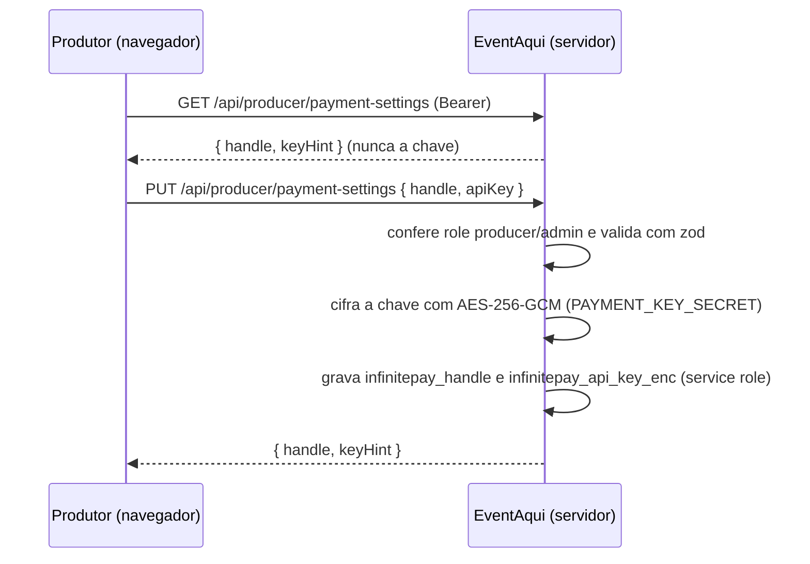
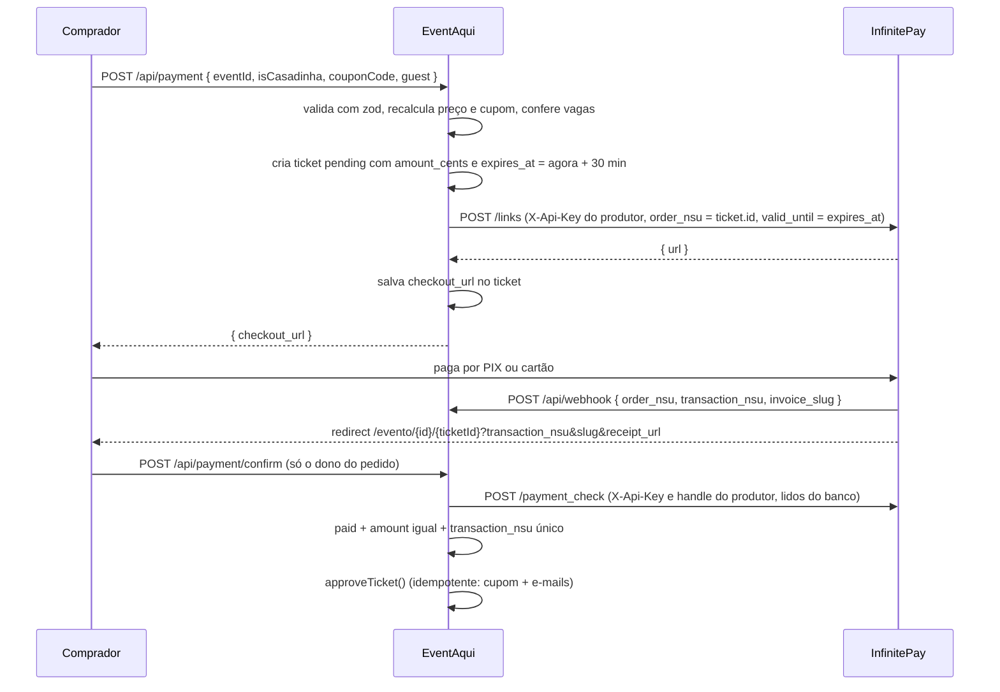

# Integração InfinitePay

Registro da integração com o Checkout Integrado da InfinitePay, o gateway de pagamento em produção. Documenta como ela funciona, as decisões de segurança e as lacunas conhecidas.

- **Situação:** em produção desde 2026-10-21 (PR #33), com PIX e cartão de crédito no checkout hospedado da InfinitePay.
- **Antes:** Mercado Pago, só com PIX. O registro está em [`mercadopago.md`](mercadopago.md) e o código na tag `mercadopago-pix`.

## Sumário

1. [Por que a InfinitePay](#1-por-que-a-infinitepay)
2. [Como funciona](#2-como-funciona)
3. [Inventário de arquivos](#3-inventário-de-arquivos)
4. [Banco de dados](#4-banco-de-dados)
5. [Variáveis de ambiente](#5-variáveis-de-ambiente)
6. [Decisões de segurança](#6-decisões-de-segurança)
7. [Taxas](#7-taxas)
8. [Lacunas conhecidas](#8-lacunas-conhecidas)
9. [Referências](#9-referências)

## 1. Por que a InfinitePay

- O público inicial é de estudantes. A InfinitePay cobra 0% no PIX e aceita conta de pessoa física (CPF).
- O cartão de crédito vem pronto no checkout hospedado, sem formulário de cartão no site.
- O cadastro do produtor é simples: InfiniteTag e API Key, sem OAuth nem renovação de token.

## 2. Como funciona

O link de pagamento é sempre criado com a API Key do produtor. O dinheiro cai direto na conta InfinitePay dele, e a plataforma não fica com nenhuma parte.

### Conexão da conta do produtor



### Compra



O webhook e a volta do checkout chamam a mesma função (`confirmPayment`). O que chegar primeiro aprova; o segundo encontra o ingresso já aprovado e não faz nada.

Evento gratuito, ou com valor zerado por cupom, é aprovado no servidor sem chamar a InfinitePay e grava `payment_method = 'free'`.

**Parâmetros do link** (`options`): `single_payment: true`, `valid_until` igual ao fim da reserva, `payment_methods_enabled: ['pix', 'credit_card']` e `assured_installments: 0` (os juros do parcelamento ficam com o comprador, se o produtor ativar o repasse no app).

## 3. Inventário de arquivos

| Arquivo | Papel |
|---|---|
| `src/lib/infinitepay.ts` | Cliente da API: `createCheckoutLink` (`/links`) e `checkPayment` (`/payment_check`). Valida as respostas com zod. |
| `src/lib/payment-confirmation.ts` | `confirmPayment`: vínculo entre pagamento e pedido, conferências e aprovação. |
| `src/lib/secret-box.ts` (+ `.test.ts`) | Cifra e decifra a API Key com AES-256-GCM. |
| `src/app/api/payment/route.ts` (+ `.test.ts`) | Cria o pedido e o link de pagamento. |
| `src/app/api/payment/confirm/route.ts` (+ `.test.ts`) | Confirmação na volta do checkout, só para o dono do pedido. |
| `src/app/api/webhook/route.ts` (+ `.test.ts`) | Recebe a notificação e chama `confirmPayment`. |
| `src/app/api/producer/payment-settings/route.ts` (+ `.test.ts`) | Lê e grava a InfiniteTag e a API Key. |
| `src/components/InfinitePayConnect.tsx` | Card "Recebimento (InfinitePay)" no `/admin`. |
| `src/app/evento/[id]/[ticketId]/page.tsx` | Tela do pedido pendente: botão para o checkout e confirmação na volta. |

## 4. Banco de dados

Tudo está em `supabase/migrations/00_schema_base.sql`.

**`profiles`:** `infinitepay_handle` (com CHECK de formato) e `infinitepay_api_key_enc`.

**`tickets`:** `amount_cents`, `payment_method` (`free`, `pix`, `credit_card`), `checkout_url`, `transaction_nsu` (UNIQUE), `invoice_slug`, `paid_amount_cents`, `installments`, `receipt_url` e `expires_at`.

**Triggers:** `protect_sensitive_profile_fields` impede o cliente de gravar as colunas `infinitepay_*`; `protect_ticket_fields` impede o cliente de alterar as colunas de pagamento do ingresso.

## 5. Variáveis de ambiente

| Variável | Uso |
|---|---|
| `PAYMENT_KEY_SECRET` | 32 bytes em base64 que cifram as API Keys. Sem ela, salvar ou usar uma chave falha. Se for perdida ou trocada, as chaves salvas ficam ilegíveis e cada produtor precisa conectar a conta de novo. |
| `NEXT_PUBLIC_SITE_URL` (via `src/lib/site.ts`) | Monta a `redirect_url` e a URL do webhook de cada link. |

Para gerar a chave:

```bash
node -e "console.log(require('crypto').randomBytes(32).toString('base64'))"
```

## 6. Decisões de segurança

1. **A notificação não aprova nada.** Ela não tem assinatura; só dispara o `payment_check`, feito com a API Key e a InfiniteTag do dono do evento, lidas do banco.
2. **Valor conferido.** O `amount` do `payment_check` precisa ser igual a `tickets.amount_cents`. Sem isso, alguém poderia criar um link de R$ 0,01 com o `order_nsu` de um pedido e aprová-lo. A comparação usa `amount`, não `paid_amount`, que inclui os juros do cartão.
3. **Transação única.** `transaction_nsu` é UNIQUE e um pedido já vinculado recusa outra transação.
4. **Comprovante.** `receipt_url` chega pela URL ou pela notificação e só é salvo se apontar para um domínio da InfinitePay.
5. **Chave do produtor.** Cifrada com AES-256-GCM, nunca devolvida ao navegador (só os 4 últimos caracteres) e protegida por trigger.
6. **Eventos de estorno e cancelamento.** `refunded` e `canceled` não são assinados no link: uma notificação sem assinatura não pode cancelar ingresso.
7. **Respostas do webhook.** Casos ignorados respondem 200. Falha ao consultar a InfinitePay, ou produtor sem chave utilizável, responde 400 para a InfinitePay tentar de novo.

## 7. Taxas

- **Plataforma:** nenhuma.
- **PIX:** 0%.
- **Cartão de crédito:** taxa da InfinitePay, conforme o plano de recebimento e o faturamento mensal do produtor. No Plano Inicial (até R$ 20 mil por mês, recebimento em 1 dia útil), a tabela pública indica 3,15% à vista e 12,40% em 12x para Visa e Mastercard. Valores atualizados em [infinitepay.io/taxas](https://www.infinitepay.io/taxas).
- **Juros do parcelamento:** ficam com o comprador se o produtor ativar o repasse de taxas no app.

## 8. Lacunas conhecidas

1. **Sem estorno por API.** O estorno é feito pelo produtor no app da InfinitePay e exige saldo. Cancelar um ingresso pago não devolve o dinheiro.
2. **Estorno não reflete no ingresso.** Um estorno feito no app não cancela o ingresso no EventAqui, porque o evento `refunded` não é confiável sem assinatura. O produtor cancela o ingresso no painel.
3. **Sem sandbox.** Testes reais usam compras de R$ 1,00.
4. **Formato do webhook por eventos.** A documentação mostra o corpo só no modelo antigo. O schema aceita `invoice_slug` ou `slug`; confirme nos logs se a InfinitePay mudar o formato.
5. **Pagamento atrasado.** Um pedido cancelado pelo cron (1 hora depois de `expires_at`) não é reativado por um pagamento tardio: o produtor recebe e-mail para estornar. Com `valid_until`, o link deixa de aceitar pagamento no fim da reserva, então o caso deve ser raro.
6. **Sem rate limit** em `/api/payment/confirm`.

## 9. Referências

- [Checkout Integrado: central de ajuda](https://ajuda.infinitepay.io/pt-BR/articles/10766888-como-usar-o-checkout-integrado-da-infinitepay)
- [Documentação interativa do checkout](https://www.infinitepay.io/checkout-documentacao)
- [Taxas](https://www.infinitepay.io/taxas)
- [Cancelamento de vendas](https://ajuda.infinitepay.io/pt-BR/articles/6097686-como-funciona-o-cancelamento-de-vendas)
