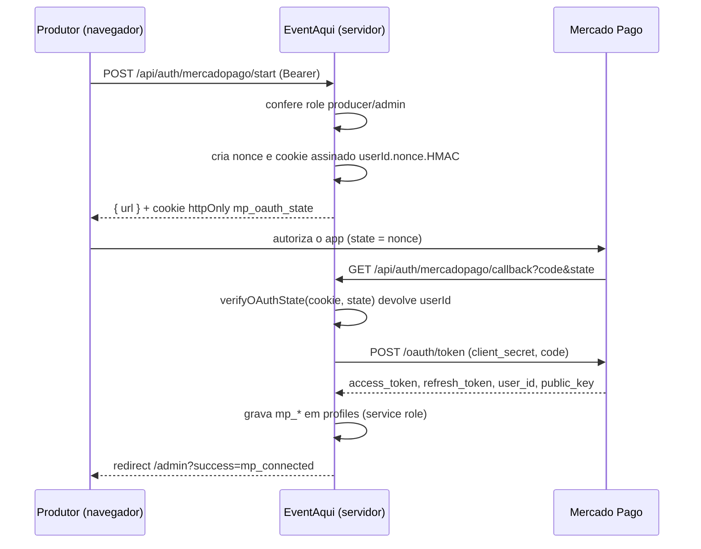
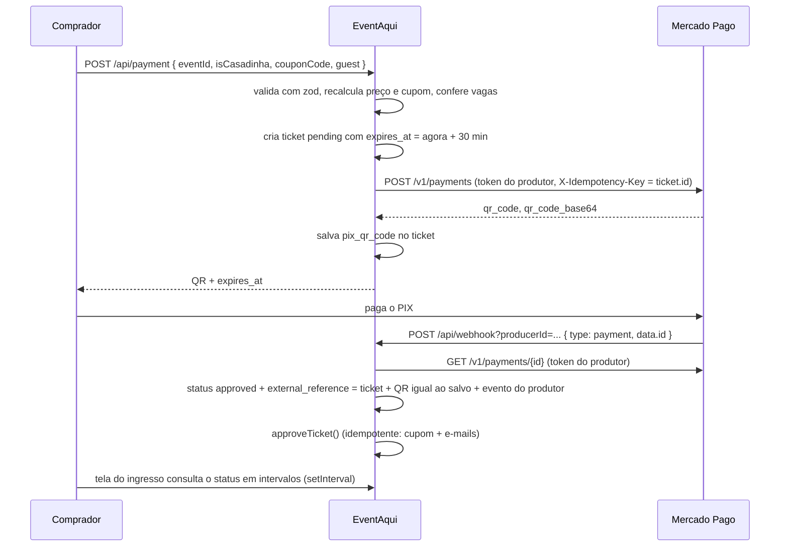

# Integração Mercado Pago

Registro da integração com o Mercado Pago (MP), o gateway de pagamento em produção. Documenta como ela funciona, as decisões de segurança e as lacunas, para que a troca planejada pelo InfinitePay, ou uma volta ao MP depois dela, não precise redescobrir o que já foi resolvido.

- **Situação:** em produção, só com PIX. O cartão de crédito foi pesquisado, mas não implementado (seção 9).
- **Troca planejada:** pelo InfinitePay (decisão de 2026-10-11). Ainda não começou: depende de confirmar as taxas do checkout online e, com o suporte do InfinitePay, a expiração do link, o sandbox e a API de estorno.
- **Quando a troca acontecer:** criar a tag Git `mp-integration-final` no commit anterior ao PR que remove o MP. Com ela, `git checkout mp-integration-final -- <caminho>` recupera qualquer arquivo.

## Sumário

1. [Por que a troca está planejada](#1-por-que-a-troca-está-planejada)
2. [Como funciona](#2-como-funciona)
3. [Inventário de arquivos](#3-inventário-de-arquivos)
4. [Banco de dados](#4-banco-de-dados)
5. [Variáveis de ambiente](#5-variáveis-de-ambiente)
6. [Decisões de segurança](#6-decisões-de-segurança)
7. [Lacunas conhecidas](#7-lacunas-conhecidas)
8. [Acoplamentos fora do código do MP](#8-acoplamentos-fora-do-código-do-mp)
9. [Cartão de crédito: plano pesquisado e não implementado](#9-cartão-de-crédito-plano-pesquisado-e-não-implementado)
10. [Como retomar depois da troca](#10-como-retomar-depois-da-troca)
11. [Referências](#11-referências)

## 1. Por que a troca está planejada

- O público inicial é de estudantes. O InfinitePay cobra 0% no PIX e tem taxas de cartão menores no plano inicial.
- O InfinitePay aceita conta de pessoa física (CPF), o que serve para produtor estudante.
- O cadastro do produtor fica mais simples: ele informa a InfiniteTag, sem OAuth e sem tokens guardados no banco.
- Manter os dois gateways ao mesmo tempo foi descartado. Isso dobraria webhooks, fluxos de estorno, telas de configuração e testes para um projeto mantido por uma pessoa.
- Nenhum produtor tem o MP conectado hoje, então a troca pode ser direta, sem período de transição.

**O que se perde com a troca** (e que o MP oferece, caso esses pontos virem requisito):

- PIX com QR exibido dentro do site. O InfinitePay usa checkout hospedado.
- API de estorno.
- Webhook com assinatura (`x-signature`) e sandbox de testes.
- Cartão sem sair do site (Card Payment Brick).
- Split automático da taxa da plataforma (`application_fee`).

**Gatilhos para manter o MP ou voltar a ele:**

- Produtores pedem o MP, por exemplo por já terem taxa negociada.
- A plataforma passa a cobrar taxa e precisa de split automático.
- Estorno por API ou PIX dentro do site viram requisito.
- O InfinitePay bloqueia contas ou muda a API de forma que inviabilize o uso.

## 2. Como funciona

O pagamento é sempre criado com o token do produtor. O dinheiro cai direto na conta MP dele, e a plataforma não fica com nenhuma parte: o código nunca usou `application_fee`.

### Conexão da conta do produtor (OAuth)



### Compra com PIX



Evento gratuito, ou com valor zerado por cupom, é aprovado no servidor sem chamar o MP.

## 3. Inventário de arquivos

Estado atual no `main`.

**Exclusivos do MP:**

| Arquivo | Papel |
|---|---|
| `src/app/api/auth/mercadopago/start/route.ts` | Inicia o OAuth. Exige produtor ou admin. Gera o `state` e o cookie. |
| `src/app/api/auth/mercadopago/callback/route.ts` | Valida o `state`, troca o `code` por tokens e grava em `profiles`. |
| `src/lib/oauth-state.ts` (+ `.test.ts`, 6 testes) | Cria e verifica o `state` assinado com HMAC. |
| `src/components/MercadoPagoConnect.tsx` | Card "Conta Bancária (PIX)" com o botão de conectar. |

**Compartilhados, com trechos do MP:**

| Arquivo | Trecho do MP |
|---|---|
| `src/app/api/payment/route.ts` (+ `.test.ts`, 13 testes) | Chamada a `/v1/payments` e gravação do QR. O resto (preço, cupom, vagas, convidado) é independente do gateway. |
| `src/app/api/webhook/route.ts` (+ `.test.ts`, 8 testes) | Todo o arquivo é do MP. |
| `src/app/admin/page.tsx` | Mostra `MercadoPagoConnect`, lê `mp_user_id` e trata `?success=mp_connected` e `?error=mp_auth_failed`. |
| `src/app/evento/[id]/_components/PixPaymentCard.tsx` | Exibe o QR e o código copia e cola. |
| `src/app/evento/[id]/[ticketId]/page.tsx` | Exibe o QR salvo e consulta o status em intervalos. |
| `src/app/evento/[id]/types.ts` | Tipo `PixData`. |
| `src/lib/tickets.ts` | `approveTicket`, `cancelTicket` e `getActiveTickets`. Independentes do gateway, mas o prazo de vaga assume o PIX de 30 min. |

## 4. Banco de dados

Tudo está em `supabase/migrations/00_schema_base.sql`.

**`profiles`:** `mp_access_token`, `mp_refresh_token`, `mp_user_id`, `mp_public_key` (todos `text`).

**`tickets`:** `pix_qr_code`, `pix_qr_code_base64`, `expires_at`.

**Trigger `protect_sensitive_profile_fields`** (`enforce_profile_protection`):
- No INSERT feito pelo app, zera as quatro colunas `mp_*`.
- No UPDATE feito pelo app, mantém os valores antigos.
- Só o service role (callback do OAuth) e o admin escrevem nelas.

**Trigger `protect_ticket_fields`:** impede o cliente de alterar `pix_qr_code`, `pix_qr_code_base64` e `expires_at`.

**Ao remover:** tirar as colunas também das duas triggers.

**Ao retomar:** recriar as colunas e incluí-las de novo nas duas triggers. Esquecer as triggers permite que o próprio produtor sobrescreva o token pelo cliente Supabase.

## 5. Variáveis de ambiente

| Variável | Uso |
|---|---|
| `NEXT_PUBLIC_MP_APP_ID` | `client_id` do app MP. É público por natureza: aparece na URL de autorização. |
| `MP_CLIENT_SECRET` | Troca do `code` por tokens e chave do HMAC do `state`. Nunca com prefixo `NEXT_PUBLIC_`. |
| `NEXT_PUBLIC_SITE_URL` (via `src/lib/site.ts`) | Monta a `redirect_uri` e a `notification_url`. A `redirect_uri` precisa ser idêntica à cadastrada no app MP. |

O app é criado no painel de desenvolvedores do MP, com o modelo de integração marketplace e a URL de redirecionamento do callback.

## 6. Decisões de segurança

Cada item resolve um ataque concreto. Mantenha todos em qualquer gateway.

1. **`state` do OAuth ligado ao usuário.** O cookie guarda `userId.nonce.HMAC`, e o MP devolve só o nonce. Sem isso, um atacante conseguiria ligar a conta MP dele ao perfil de outro produtor (CSRF de login) ou o contrário. A comparação usa `timingSafeEqual`, e o cookie é `httpOnly`, `sameSite=lax`, restrito a `/api/auth/mercadopago`, com validade de 10 minutos.
2. **O callback não confia em nenhum id vindo da URL.** O usuário sai só do cookie verificado.
3. **Preço sempre recalculado no servidor.** O cliente envia `eventId`, cupom e quantidade; nunca valor.
4. **Webhook não confiável.** A notificação traz só o id do pagamento. O status vem de `GET /v1/payments/{id}` com o token do produtor.
5. **Vínculo forte entre pagamento e ingresso.** Para aprovar, o webhook exige:
   - `external_reference` igual ao id do ingresso;
   - o QR do pagamento igual ao `pix_qr_code` salvo;
   - o evento do ingresso pertencente ao `producerId` da notificação.

   Isso impede aprovar um ingresso com um pagamento aprovado de outro pedido ou de outra conta.
6. **`X-Idempotency-Key` = id do ingresso.** Uma nova tentativa da mesma requisição não gera dois PIX.
7. **`approveTicket` idempotente.** O UPDATE só aprova ingresso `pending` (`.eq('payment_status', 'pending')`), então só a primeira chamada conta o cupom e envia e-mails.
8. **Respostas do webhook.** Casos ignorados respondem 200 para o MP não reenviar. Erro de configuração responde 400. Falha ao consultar o MP responde 502, e o MP tenta de novo.
9. **Tokens fora do alcance do cliente.** Ficam protegidos pela trigger e só são lidos pelo `supabaseAdmin` no servidor.

## 7. Lacunas conhecidas

Problemas que existem hoje. Se o MP continuar, ou voltar depois da troca, resolva antes de abrir para mais produtores.

1. **Webhook sem validação de `x-signature`.** O risco é baixo, porque o status é sempre consultado no MP, mas a validação evita consultas forçadas por terceiros. Precisa do segredo de webhook do app.
2. **Renovação de token não implementada.** O `mp_refresh_token` é salvo, mas nunca usado. O access token do MP expira (prazo na documentação de OAuth), e depois disso o produtor perde a capacidade de vender até reconectar. Implemente a renovação com `grant_type=refresh_token`, sob demanda ao receber 401 ou por cron.
3. **Pagamento tardio: corrigido no PR #28.** O `approveTicket` aprovava ingresso cancelado ou vencido sem conferir vagas, o que podia vender acima da lotação. A regra atual, que não depende de gateway:
   - aprova só ingresso `pending`;
   - se o pagamento chega depois de `expires_at`, aprova só se ainda houver vaga; sem vaga, cancela o ingresso;
   - pagamento de ingresso cancelado não reativa nada.

   Nos dois casos de recusa, o produtor recebe um e-mail pedindo o estorno manual. A coluna `tickets.refund_requested_at` garante um único e-mail mesmo com notificações repetidas. Ingresso cancelado pela exclusão de conta (sem `user_id`) não gera aviso. O cron `cancel-expired-orders` cancela pedidos pendentes 1 hora depois de `expires_at`.
4. **Cancelar não cancela o PIX no MP.** O QR continua pagável até expirar no MP.
5. **Sem estorno.** Cancelar um ingresso pago não devolve o dinheiro pela API.
6. **Webhook sem conferência de valor.** Não compara `transaction_amount` com o valor esperado. O vínculo pelo QR já cobre esse caso no PIX, mas no cartão a conferência é obrigatória.
7. **Desconectar a conta.** Não existe fluxo para o produtor desvincular ou trocar a conta MP.

## 8. Acoplamentos fora do código do MP

Pontos que dependem do PIX do MP sem estar nos arquivos da integração. Eles quebram ou mudam de sentido na troca de gateway e precisam entrar no PR da troca.

- **Heurística "ingresso sem cobrança".** `src/app/admin/orders/page.tsx` e `src/app/tickets/_hooks/useMyTickets.ts` usam `!t.pix_qr_code` para inferir que o ingresso foi gratuito e herdar o cupom do convidado. Com outro gateway, todo ingresso pago fica sem `pix_qr_code`. Substitua por um campo explícito, como `payment_method` ou o valor cobrado.
- **Prazo de reserva de 30 min.** `PIX_EXPIRATION_MINUTES` em `/api/payment` e o filtro de `getActiveTickets` assumem que o pagamento expira com o PIX.
- **Pedido pendente na página do evento.** `useEventDetails` trata o `expires_at` vencido.
- **Polling na tela do ingresso.** `[ticketId]/page.tsx` consulta o status em intervalos e não depende do gateway, mas exibe o QR salvo.

## 9. Cartão de crédito: plano pesquisado e não implementado

Pesquisado em 2026-10-11, antes da decisão de trocar de gateway. Está suspenso: com a troca, o cartão passa a vir do checkout do InfinitePay. Vale só se o MP continuar ou voltar.

**Decisões:**
- Card Payment Brick (`@mercadopago/sdk-react`, componente `CardPayment`), ao lado da tela própria de PIX.
- Brick iniciado com a `mp_public_key` do produtor, que já é salva no callback.
- Sem taxa da plataforma.
- Sem limite de parcelas no app. O comprador escolhe e paga os juros. O produtor pode oferecer parcelas sem juros na conta MP dele. O zod só confere que `installments` é inteiro positivo, e o MP recusa contagens inválidas.

**Por que Brick e não Checkout Pro:** segue o padrão do PIX (o backend cria o pagamento em `/v1/payments`), o comprador não sai do site e a public key já está disponível. O Wallet Brick ("Pagar com Mercado Pago") pode ser somado depois, se a taxa de aprovação ficar baixa.

**Mudanças previstas:**
- Banco: `tickets.payment_method` (`pix` | `card`, com CHECK) e `tickets.mp_payment_id` (unique), incluídos na trigger `protect_ticket_fields`.
- Body de `/api/payment`: `method`, mais `token`, `installments`, `payment_method_id`, `issuer_id` e `payer` (e-mail e CPF do titular) quando o método é cartão. O `transaction_amount` do cliente é ignorado.
- Resposta do MP no cartão:
  - `approved`: aprova o ingresso na hora;
  - `rejected`: cancela o ingresso e mostra uma mensagem conforme o `status_detail`;
  - `in_process`: o ingresso fica pendente e o webhook decide.
- Webhook: vínculo por `mp_payment_id` no cartão, conferência de `transaction_amount` e aprovação só a partir de `pending`.
- `expires_at` maior para cartão `in_process` (proposta: 48 h), para o cron não cancelar um pagamento ainda em análise.
- Recomendação da documentação do MP: aderir ao 3DS 2.0 e enviar o device id do script de segurança, para aumentar a aprovação.

**Quem paga cada taxa no MP:**
- Taxa de processamento: sai do valor do produtor. O percentual depende do prazo de recebimento que ele escolhe na conta MP (na hora, 14 ou 30 dias).
- Juros de parcelamento: por padrão, do comprador. O produtor pode absorvê-los oferecendo parcelas sem juros.
- Taxa da plataforma (`application_fee`): definida pelo código a cada pagamento e descontada do produtor. Para o comprador pagar essa taxa, some uma taxa de serviço ao preço em `src/lib/pricing.ts`.

## 10. Como retomar depois da troca

Vale depois que a troca for feita. A troca pelo InfinitePay deve criar a interface de gateway (`createCharge` / `verifyPayment`). Retomar o MP significa escrever um segundo adaptador para essa interface, não restaurar os arquivos antigos por cima.

1. **Leia a seção 7** e decida como tratar cada lacuna.
2. **Confira a documentação atual do MP:** OAuth, `/v1/payments`, webhook com `x-signature`, Bricks. Os parâmetros mudam com frequência.
3. **Recupere o código de referência:**
   ```bash
   git show mp-integration-final:src/app/api/webhook/route.ts
   git checkout mp-integration-final -- src/lib/oauth-state.ts src/lib/oauth-state.test.ts
   ```
   `oauth-state.ts` pode voltar quase sem mudança. As rotas e o webhook servem de base para o adaptador.
4. **Banco** (`00_schema_base.sql` e SQL para produção): colunas `mp_*` em `profiles`, de volta nas duas triggers (seção 4).
5. **Ambiente:** `NEXT_PUBLIC_MP_APP_ID`, `MP_CLIENT_SECRET` e, se validar a assinatura, o segredo do webhook. Confira a `redirect_uri` no painel do MP.
6. **Adaptador MP:**
   - `createCharge`: o `fetch` de `/v1/payments` com o token do produtor e `X-Idempotency-Key`.
   - `verifyPayment`: a consulta de `GET /v1/payments/{id}` e o vínculo da seção 6, item 5.
7. **Escolha por produtor:** guarde qual gateway o produtor usa e mostre o `MercadoPagoConnect` (recuperado da tag) só para quem escolher o MP.
8. **Renovação de token** (lacuna 2), antes de liberar para produtores.
9. **Testes:** recupere os testes da tag (`payment` 13, `webhook` 8, `oauth-state` 6) e adapte-os à interface.
10. **Cartão:** siga a seção 9.

## 11. Referências

- [OAuth do Mercado Pago](https://www.mercadopago.com.br/developers/pt/docs/security/oauth/introduction)
- [Notificações e webhooks](https://www.mercadopago.com.br/developers/pt/docs/your-integrations/notifications/webhooks)
- [Card Payment Brick: renderização padrão](https://www.mercadopago.com.br/developers/pt/docs/checkout-bricks/card-payment-brick/default-rendering)
- [Card Payment Brick: envio do pagamento](https://www.mercadopago.com.br/developers/pt/docs/checkout-bricks/card-payment-brick/payment-submission)
- [InfinitePay: documentação do checkout](https://www.infinitepay.io/checkout-documentacao)
